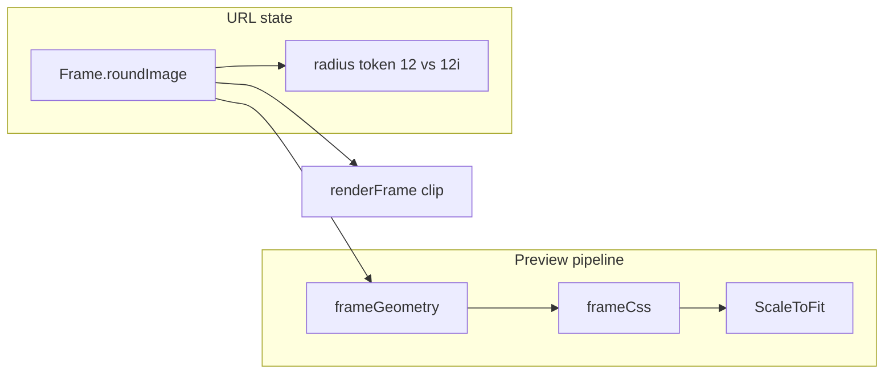

# Editor UI and Radius-on-Image Fixes

> **For agentic workers:** REQUIRED SUB-SKILL: Use superpowers:subagent-driven-development (recommended) or superpowers:executing-plans to implement this plan task-by-task. Steps use checkbox (`- [ ]`) syntax for tracking.

**Goal:** Make landing frames and the editor preview hold together with no image and on narrow viewports, stop the theme menu from sitting under the sticky header, give slider thumbs a pointer cursor, and add a “round the picture” option under Corner radius.

**Architecture:** Shared `ScaleToFit` contains the CSS-scale preview so layout size cannot leak. `frameCss` insets the mat by stroke thickness so box-shadows stay inside the composed box. Overlay `z-index` moves onto the Base UI Positioner (the portaled element). `roundImage` is a boolean on `Frame`, encoded as an `i` suffix on the radius token so v1/v2 links keep working.

**Tech Stack:** Astro + React islands, Tailwind v4 tokens, Base UI primitives, Zod + nuqs URL codec, `scripts/verify-frame.ts` (no Vitest in this repo).

**Spec:** Product notes in this request, plus [PRODUCT.md](PRODUCT.md) and [DESIGN.md](DESIGN.md). Register is product: quiet chrome, 44px targets, AA contrast, parameters over panels.

**Save a copy** of this plan to `docs/superpowers/plans/2026-08-29-editor-ui-fixes.md` at the start of execution (writing-plans convention). The repo currently has no `docs/superpowers/plans/` directory.

## Global Constraints

- No new packages. No Vitest. Extend `scripts/verify-frame.ts` and run `pnpm verify`, `pnpm check`, `pnpm typecheck`.
- No barrel files. Imports use `#/*` for cross-feature, relative paths inside `src/features/frame/`.
- Arrow-const components, `type` (not `interface`), no `React.FC`, no comments unless a genuine why.
- shadcn 5-part pass is N/A: do not add a Checkbox primitive. One native labeled checkbox is enough.
- Touch targets stay ≥44px (`min-h-11`). Accent (oxidized teal) only for the checked/primary state, paired with the native checkmark.
- `prefers-reduced-motion` is already global; do not add entrance animations.
- Browser-verify at ~375px and ~1280px before claiming done (`pnpm dev` is already running).

## File Structure

- Create: [src/features/frame/components/ScaleToFit.tsx](src/features/frame/components/ScaleToFit.tsx) — overflow-clipped CSS-scale shell used by editor and landing previews.
- Create: [src/features/frame/components/RadiusControls.tsx](src/features/frame/components/RadiusControls.tsx) — radius slider + “Round the picture” checkbox.
- Modify: [src/features/frame/frame.css.ts](src/features/frame/frame.css.ts) — inset mat by `totalThickness`; clip descendants to radius.
- Modify: [src/features/frame/frame.schema.ts](src/features/frame/frame.schema.ts), [frame.codec.ts](src/features/frame/frame.codec.ts), [frame.geometry.ts](src/features/frame/frame.geometry.ts), [frame.canvas.ts](src/features/frame/frame.canvas.ts), [hooks/useFrameState.ts](src/features/frame/hooks/useFrameState.ts) — `roundImage`.
- Modify: [FrameStage.tsx](src/features/frame/components/FrameStage.tsx), [PresetCard.tsx](src/features/landing/components/PresetCard.tsx), [FrameEditor.tsx](src/features/frame/components/FrameEditor.tsx), [ColorField.tsx](src/features/frame/components/ColorField.tsx), [StrokeEditorPopover.tsx](src/features/frame/components/StrokeEditorPopover.tsx), [DropOverlay.tsx](src/features/frame/components/DropOverlay.tsx).
- Modify: [slider.tsx](src/components/ui/slider.tsx), [dropdown-menu.tsx](src/components/ui/dropdown-menu.tsx), [popover.tsx](src/components/ui/popover.tsx).
- Modify: [scripts/verify-frame.ts](scripts/verify-frame.ts), [DESIGN.md](DESIGN.md).



---

### Task 1: Contain previews (empty image + mobile overflow)

**Files:**
- Create: `src/features/frame/components/ScaleToFit.tsx`
- Modify: `src/features/frame/frame.css.ts`
- Modify: `src/features/frame/components/FrameStage.tsx`
- Modify: `src/features/landing/components/PresetCard.tsx`
- Modify: `src/features/landing/components/PresetGallery.tsx`
- Modify: `src/features/frame/components/FrameEditor.tsx` (grid `min-w-0` only)
- Modify: `src/features/frame/components/DropOverlay.tsx` if `frameCss` margin needs a wrapping adjustment
- Test: `scripts/verify-frame.ts`

**Why this is broken:** CSS `transform: scale()` does not shrink layout. `FrameStage` placeholder is 480×360 and landing samples are 320×240; grid items default to `min-width: auto`, so the unscaled tree forces horizontal scroll and overlapping cards—worst when there is no photo (scale stays near 1). Separately, `box-shadow` rings sit on an un-inset mat, so strokes paint up/left outside `composedSize` (a few pixels with a huge photo, obviously broken at placeholder scale).

**Interfaces:**
- Consumes: `FrameGeometry.composedSize`, `frameCss(geometry)`
- Produces: `ScaleToFit({ width, height, scale, className, children })`; `frameCss` returns `margin: geometry.totalThickness` and `overflow: 'hidden'`

- [ ] **Step 1: Write failing verify assertions**

Add to `scripts/verify-frame.ts` (import `frameCss` / `frameGeometry`):

```ts
const previewGeometry = frameGeometry(DEFAULT_FRAME, { width: 480, height: 360 });
const previewCss = frameCss(previewGeometry);

assert(
  previewCss.margin === previewGeometry.totalThickness,
  'frame CSS must inset by stroke thickness so box-shadows fit composedSize',
);
assert(previewCss.overflow === 'hidden', 'frame CSS must clip the inner image to the rounded mat');
```

- [ ] **Step 2: Run verify to confirm it fails**

Run: `pnpm verify`
Expected: FAIL on the new margin/overflow assertions.

- [ ] **Step 3: Implement `frameCss` inset + clip**

In `frame.css.ts`, return (keep the existing shadow loop):

```ts
return {
  display: 'block',
  boxSizing: 'border-box',
  padding: geometry.matPadding,
  backgroundColor: geometry.matColor,
  borderRadius: geometry.radius,
  boxShadow: shadows.length > 0 ? shadows.join(', ') : undefined,
  margin: geometry.totalThickness,
  overflow: 'hidden',
};
```

Remove `className="inline-block"` from FrameStage / PresetCard frame nodes (display comes from the style object). DropOverlay applies `frameCss` to the dialog panel; extra margin is correct (shadows currently overflow there too). Leave it.

- [ ] **Step 4: Add `ScaleToFit` and wire both previews**

```tsx
import type { ReactNode } from 'react';

type ScaleToFitProps = {
  width: number;
  height: number;
  scale: number;
  className?: string;
  children: ReactNode;
};

export const ScaleToFit = ({ width, height, scale, className, children }: ScaleToFitProps) => (
  <div className={className} style={{ width: width * scale, height: height * scale, overflow: 'hidden' }}>
    <div
      style={{
        width,
        height,
        transform: `scale(${scale})`,
        transformOrigin: 'top left',
      }}
    >
      {children}
    </div>
  </div>
);
```

`FrameStage`: wrap the framed content in `ScaleToFit` using existing `scale` / `composedSize`. Add `min-w-0` on the `<section>`. Keep the 480×360 placeholder and “your image” copy.

`PresetCard`: replace the inner size wrapper with `ScaleToFit`. Change the outer box from fixed `260×200` to `w-full max-w-full` with `aspect-[13/10]` (same 260:200 ratio) so cards shrink on a 320px viewport. Compute scale from that box’s width/height: use a `useState`+`ResizeObserver` like FrameStage, **or** keep the current `Math.min(1, boxW/composedW, boxH/composedH)` but pass `boxW` from a ref. ResizeObserver is the one that survives padding changes.

Empty-state inner panel: stop filling with `preset.frame.matColor` (mat and picture become one blob). Use `bg-muted` like FrameStage so the mat reads as a mat.

`PresetGallery` grid: `min-w-0` on the grid. `FrameEditor` outer grid: `min-w-0`; first column already `minmax(0,1fr)` at `lg` — add `min-w-0` on `FrameStage` and the `<aside>` so below `lg` the 480px placeholder cannot widen the page.

- [ ] **Step 5: Re-run verify**

Run: `pnpm verify`
Expected: PASS (including new assertions).

- [ ] **Step 6: Browser-check empty previews**

Landing `/` with no photo: four frames fully visible, no horizontal scroll at 375px, inner panel distinct from mat. Editor `/editor` with no image: placeholder and strokes fully inside the stage, no page-wide horizontal scroll.

- [ ] **Step 7: Commit**

```bash
git add src/features/frame/components/ScaleToFit.tsx src/features/frame/frame.css.ts \
  src/features/frame/components/FrameStage.tsx src/features/frame/components/FrameEditor.tsx \
  src/features/frame/components/DropOverlay.tsx src/features/landing/components/PresetCard.tsx \
  src/features/landing/components/PresetGallery.tsx scripts/verify-frame.ts
git commit -m "$(cat <<'EOF'
fix: contain frame previews so empty and mobile layouts do not overflow

EOF
)"
```

---

### Task 2: Overlay stacking + slider pointer

**Files:**
- Modify: `src/components/ui/dropdown-menu.tsx`
- Modify: `src/components/ui/popover.tsx`
- Modify: `src/components/ui/slider.tsx`
- Modify: `DESIGN.md` (z-index sentence)

**Why this is broken:** Portals render to `document.body`, but `z-[var(--z-dropdown)]` is on the **Popup**. The **Positioner** is the `position: absolute/fixed` child of body and has `z-index: auto`, so the sticky header (`z-sticky: 10`) paints over the top of the theme menu. Slider thumbs have no `cursor-pointer`.

**Interfaces:**
- Consumes: `--z-dropdown`, `--z-sticky` in `src/styles/tokens/spacing.css` (already 20 > 10)
- Produces: Positioner carries the z-index; Thumb/Control use pointer cursor

- [ ] **Step 1: Move z-index to Positioner**

`dropdown-menu.tsx` — add `className="z-[var(--z-dropdown)]"` to `BaseMenu.Positioner`; remove z-index from Popup.

`popover.tsx` — same on `BasePopover.Positioner` (stroke editor must clear the header too).

Keep `collisionPadding={8}`. Do not invent a new z-token.

- [ ] **Step 2: Slider cursor**

On `BaseSlider.Root` add `data-[disabled]:cursor-not-allowed`. On `BaseSlider.Control` and `BaseSlider.Thumb` add `cursor-pointer`.

- [ ] **Step 3: DESIGN.md**

Update Elevation: popovers/menus apply `--z-dropdown` on the **positioner** so they stack above `--z-sticky` SiteHeader.

- [ ] **Step 4: Browser-check**

Open theme menu on `/` and `/editor`. The full Light/Dark/System list is visible and clickable; header does not cover the top. Hover a radius/padding thumb: cursor is pointer.

- [ ] **Step 5: Commit**

```bash
git commit -m "$(cat <<'EOF'
fix: stack overlays above the sticky header and use a pointer on slider thumbs

EOF
)"
```

---

### Task 3: Mobile control rail

**Files:**
- Modify: `src/features/frame/components/ColorField.tsx`
- Modify: `src/features/frame/components/StrokeEditorPopover.tsx`
- Modify: `src/features/frame/components/FrameStage.tsx` (stage min-height only if still cramped after Task 1)

**Why this is still broken after Task 1:** Color hex `<input>` has an intrinsic min-width, so the swatch + hex + opacity row overflows ~320px rails. Stroke popover is `side="left"` with 20rem width — on a single-column rail it needs to flip and clear the header.

**Interfaces:**
- Consumes: `PopoverContent` `side` / `collisionPadding`
- Produces: wrapping ColorField; popover `collisionPadding` object with extra top inset

- [ ] **Step 1: ColorField shrink/wrap**

On the hex `Input`: add `min-w-0`. On the row: `flex-wrap`. Keep the 44px swatch. Opacity `w-14` stays; wrapping is the overflow valve.

- [ ] **Step 2: Stroke popover collision**

In `StrokeEditorPopover`, set `collisionPadding={{ top: 72, right: 8, bottom: 8, left: 8 }}` so Floating UI clears SiteHeader (~68px). Keep `side="left"` — Base UI collision avoidance will flip to bottom on a full-width mobile rail. Do not add a matchMedia side switch unless browser-check shows it still clipped.

- [ ] **Step 3: Stage height on small screens (only if needed)**

If the empty stage still eats the first viewport, change FrameStage from `min-h-[min(50vh,28rem)]` to `min-h-[min(40vh,20rem)] lg:min-h-[min(50vh,28rem)]`. Skip this if Task 1 already made the page usable.

- [ ] **Step 4: Browser-check at 375×667**

Editor: no horizontal scroll; color row readable; open a stroke — editor is fully on-screen and not under the header; Download/Copy stack vertically (already `flex-col` then `sm:flex-row`). Landing gallery: two stacked cards, then two columns from `sm` without overflow.

- [ ] **Step 5: Commit**

```bash
git commit -m "$(cat <<'EOF'
fix: keep editor controls usable on narrow viewports

EOF
)"
```

---

### Task 4: Round-the-picture option

**Files:**
- Modify: `src/features/frame/frame.schema.ts`
- Modify: `src/features/frame/frame.codec.ts`
- Modify: `src/features/frame/frame.geometry.ts`
- Modify: `src/features/frame/frame.canvas.ts`
- Modify: `src/features/frame/hooks/useFrameState.ts`
- Modify: `src/features/frame/components/DropOverlay.tsx` (`OVERLAY_FRAME`)
- Create: `src/features/frame/components/RadiusControls.tsx`
- Modify: `src/features/frame/components/FrameEditor.tsx`
- Modify: `src/features/frame/components/FrameStage.tsx`
- Modify: `src/features/landing/components/PresetCard.tsx` (inner `borderRadius` when a photo is shown; presets stay `roundImage: false`)
- Test: `scripts/verify-frame.ts`
- Modify: `DESIGN.md` rail order sentence

**Product decision:** The existing Radius slider continues to round the **mat and strokes**. The new checkbox applies **the same numeric radius** to the image rectangle (not `radius - padding`). Default off. Copy: label `Round the picture`.

**Interfaces:**
- Consumes: `Frame.radius`, `NumberField`
- Produces:
  - `Frame.roundImage: boolean` (required; default `false` on all existing literals)
  - `setRoundImage(roundImage: boolean)` from `useFrameState`
  - Codec: radius token `12` vs `12i`; no version bump; v1/v2 links decode with `roundImage: false`
  - `FrameGeometry.roundImage: boolean`
  - `RadiusControls({ radius, roundImage, onRadiusChange, onRoundImageChange })`

- [ ] **Step 1: Write failing codec/schema assertions**

In `scripts/verify-frame.ts`, add `roundImage: false` to every existing frame fixture (including `DEFAULT_FRAME` via schema — **do not** change the DEFAULT_FRAME encode string `1.24.f7f4ec.0~16-1a3a3f~4-c9a227~2-1a3a3f`).

```ts
assert(
  decodeFrame('1.24.f7f4ec.12i~16-1a3a3f')?.roundImage === true,
  'radius token suffix i should set roundImage',
);
assert(
  decodeFrame('1.24.f7f4ec.12i~16-1a3a3f')?.radius === 12,
  'i suffix must not change the numeric radius',
);
assert(
  decodeFrame('1.24.f7f4ec.0~16-1a3a3f~4-c9a227~2-1a3a3f')?.roundImage === false,
  'legacy links default roundImage to false',
);

const rounded = { ...DEFAULT_FRAME, radius: 12, roundImage: true };
assert(encodeFrame(rounded).includes('.12i~'), 'roundImage should encode as radius i suffix');
verifyRoundTrip('roundImage frame', rounded);

assert(
  decodeFrame('1.24.f7f4ec.12i~16-1a3a3f') !== null &&
    encodeFrame(decodeFrame('1.24.f7f4ec.12i~16-1a3a3f')!) === '1.24.f7f4ec.12i~16-1a3a3f',
  'i-suffix frames should round-trip',
);
```

- [ ] **Step 2: Run verify — expect FAIL** (`roundImage` not on Frame / encode ignores `i`)

- [ ] **Step 3: Schema + codec + geometry**

`frame.schema.ts`:

```ts
export const frameSchema = z.object({
  padding: z.number().int().min(0).max(400),
  matColor: hexColor,
  radius: z.number().int().min(0).max(200),
  roundImage: z.boolean().default(false),
  strokes: z.array(strokeSchema).max(8),
});
```

Add `roundImage: false` to each preset and `OVERLAY_FRAME`.

`frame.codec.ts` encode:

```ts
const radiusToken = `${frame.radius}${frame.roundImage ? 'i' : ''}`;
return `${version}.${frame.padding}.${matColor}.${radiusToken}~${strokes}`;
```

Decode: `const radiusToken = radiusAndStrokes.slice(0, tilde)`; `roundImage = radiusToken.endsWith('i')`; parse radius from the token with the suffix stripped. Pass `roundImage` into `frameSchema.safeParse`.

`frame.geometry.ts`: add `roundImage: frame.roundImage` to the returned geometry.

- [ ] **Step 4: Canvas clip**

In `renderFrame`, after filling the mat, before `drawImage`:

```ts
if (geometry.roundImage) {
  ctx.save();
  ctx.beginPath();
  traceRoundedRect(
    ctx,
    matX + matPadding,
    matY + matPadding,
    imageSize.width,
    imageSize.height,
    radius,
  );
  ctx.clip();
}
ctx.drawImage(bitmap, matX + matPadding, matY + matPadding, imageSize.width, imageSize.height);
if (geometry.roundImage) {
  ctx.restore();
}
```

`traceRoundedRect` already clamps radius to half-width/height.

- [ ] **Step 5: Run verify — expect PASS**

- [ ] **Step 6: UI — `RadiusControls`**

```tsx
type RadiusControlsProps = {
  radius: number;
  roundImage: boolean;
  onRadiusChange: (radius: number) => void;
  onRoundImageChange: (roundImage: boolean) => void;
};

export const RadiusControls = ({
  radius,
  roundImage,
  onRadiusChange,
  onRoundImageChange,
}: RadiusControlsProps) => {
  const id = useId();
  return (
    <section className="flex flex-col gap-4" aria-labelledby="radius-heading">
      <h2 id="radius-heading" className="type-label text-foreground">
        Corner radius
      </h2>
      <NumberField label="Radius" value={radius} onChange={onRadiusChange} min={0} max={200} />
      <label htmlFor={id} className="flex min-h-11 cursor-pointer items-center gap-3">
        <input
          id={id}
          type="checkbox"
          checked={roundImage}
          onChange={(event) => onRoundImageChange(event.target.checked)}
          className="size-5 shrink-0 accent-primary"
        />
        <span className="type-label text-foreground">Round the picture</span>
      </label>
    </section>
  );
};
```

`useFrameState`: `setRoundImage` mirroring `setRadius`. `FrameEditor` replaces the inline Corner radius section with `RadiusControls`.

`FrameStage` inner canvas/placeholder: `style={{ borderRadius: geometry.roundImage ? geometry.radius : undefined }}`. Same on `PresetCard` `` (no-op until a future preset sets the flag).

- [ ] **Step 7: DESIGN.md**

Rail order: Image → Presets → Mat → Strokes → Corner radius (slider + Round the picture) → Export. One sentence: radius rounds mat/strokes; the checkbox applies the same value to the image, persisted as `i` on the radius token.

- [ ] **Step 8: Browser-check**

Editor with a photo: raise Radius — frame rounds, photo stays square. Check “Round the picture” — photo corners match. Copy link, reload — checkbox stays on. Uncheck — square photo, rounded frame. Export PNG matches the preview. At 375px the checkbox row is a full 44px target.

- [ ] **Step 9: `pnpm check` + `pnpm typecheck` + commit**

```bash
git commit -m "$(cat <<'EOF'
feat: optionally apply corner radius to the picture

EOF
)"
```

---

## Self-review

1. **Spec coverage:** empty frames/previews → Task 1; theme menu vs header → Task 2; mobile editor → Tasks 1+3; slider cursor → Task 2; radius-on-image → Task 4.
2. **Placeholders:** none; codec, CSS, and component code are specified.
3. **Types:** `roundImage` is `boolean` on `Frame`, `FrameGeometry`, `setRoundImage`, and `RadiusControls` throughout.

## Browser verification (end of execution)

Use the running `pnpm dev` server. Exercise: landing empty gallery; drop a photo onto gallery; editor empty; editor with image; theme menu light/dark/system; radius slider hover; round-the-picture on/off + download; 375px and 1280px. If something still overflows, fix before finishing — do not ship Task 1/3 unverified.
